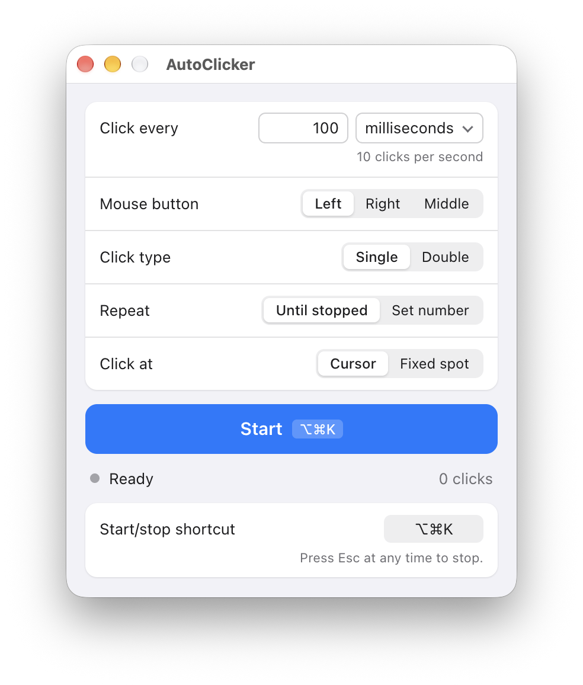

<p align="center">
  
</p>

<h1 align="center">AutoClicker for Mac</h1>

<p align="center">A free, open-source autoclicker for macOS.<br/>Choose how often to click, press ⌥⌘K, and it clicks for you.</p>

<p align="center">
  <picture>
    <source media="(prefers-color-scheme: dark)" srcset="docs/screenshot-dark.png"/>
    
  </picture>
</p>

## Install

1. Download the latest DMG from [Releases](https://github.com/erikkostashuk/autoclicker-for-mac/releases/latest). Pick **arm64** for Apple Silicon Macs (M1 or newer) or **x64** for Intel Macs. Not sure which you have? Check **Apple menu → About This Mac**. Requires macOS 13 or later.
2. Open the DMG and drag **AutoClicker for Mac** into **Applications**.
3. Open the app. The first time, macOS blocks it because it isn't notarized by Apple. Go to **System Settings → Privacy & Security** and click **Open Anyway**.
4. When asked, turn on **Accessibility** access. macOS requires this before any app can click for you.

## Features

- Click as often as every millisecond or as rarely as once a day, with precise timing
- Left, right or middle button, single or double clicks
- Click until you stop, or a set number of times
- Click where the cursor is, or at a fixed spot you pick on screen
- Start and stop from any app with ⌥⌘K (you can change it). Esc always stops.
- Remembers your settings and follows light and dark mode

## Help

- **Clicking stopped working after an update.** Open **System Settings → Privacy & Security → Accessibility**, remove AutoClicker for Mac with the **–** button, then open the app and turn access on again.
- **Clicks lag or keep going for a moment after stopping.** macOS handles about 200 clicks per second at most. Use a longer interval.
- **The shortcut doesn't work.** Another app may be using it. Click the shortcut in AutoClicker and press a new one.
- **Something else?** [Open an issue](https://github.com/erikkostashuk/autoclicker-for-mac/issues/new).

## Development

You need [Node.js 24](https://nodejs.org) and the Xcode Command Line Tools (`xcode-select --install`).

```bash
npm install
npm start      # run the app
npm test       # run the tests
npm run dist   # build the DMGs into dist/
```

The app is built with Electron (`src/`) plus a small native click engine (`native/clicker.m`). When you run it with `npm start`, macOS asks for Accessibility access for your terminal app instead of AutoClicker.

Every push to `main` publishes a new release automatically, with the next patch version (1.4.1, 1.4.2, …). To start a new minor or major version, change `version` in `package.json`. Changes to docs alone don't publish a release.

## License

[MIT](LICENSE)
